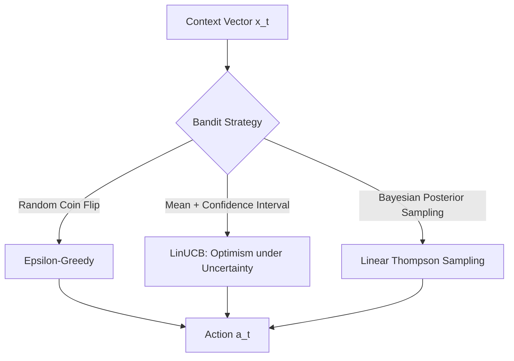

# Reinforcement Learning & Contextual Bandits Primer
### Bridging Causal Uplift Modeling and Online Decision Making

---

## 1. Introduction: What is Reinforcement Learning (RL)?

In **Supervised Learning**, a static dataset with ground-truth labels is provided:

$$\text{Input } X \longrightarrow \text{Model } f(X) \longrightarrow \text{Predicted Target } \hat{Y}$$

The model is evaluated against known ground-truth targets $Y$.

In **Reinforcement Learning**, there are **no pre-existing ground-truth labels**. Instead, an autonomous **Agent** learns by trial-and-error interaction with an **Environment**:

```
                 ┌───────────────────┐
                 │       Agent       │
                 └─────────┬─────────┘
        Action a_t         │ ▲  Context / State x_t
        (e.g., Show Ad)    │ │  Reward r_t (e.g., Conversion - Cost)
                           ▼ │
                 ┌───────────┴───────┐
                 │    Environment    │
                 └───────────────────┘
```

At every discrete step $t$:
1. The **Environment** reveals a state or context vector $x_t \in \mathbb{R}^d$ (e.g., user browsing history, cart value, ad fatigue).
2. The **Agent** picks an action $a_t \in \mathcal{A}$ according to its policy $\pi(a \mid x_t)$.
3. The **Environment** returns a scalar reward $r_t \in \mathbb{R}$.
4. The agent updates its parameters to maximize expected **cumulative reward** over the horizon $T$:

$$\max_\pi \mathbb{E}\left[ \sum_{t=1}^T r_t \right]$$

---

## 2. The RL Spectrum

RL problems are categorized by whether actions affect future states and whether state features exist:

| Paradigm | Context / Features ($x_t$)? | Do Actions Change Future States? | Canonical Example |
| :--- | :---: | :---: | :--- |
| **Multi-Armed Bandit (MAB)** | ❌ None | ❌ No (stateless rounds) | Choosing between slot machines at a casino. |
| **Contextual Bandit** | ✅ Yes ($x_t \in \mathbb{R}^d$) | ❌ No (each visitor arrives independently) | Personalized news feed, dynamic ad targeting. |
| **Full RL (MDP)** | ✅ Yes ($s_t \in \mathcal{S}$) | ✅ Yes ($s_{t+1} \sim P(s_{t+1} \mid s_t, a_t)$) | Chess, Go, video games, robotic navigation. |

> [!NOTE]
> **Contextual Bandits** represent the essential stepping stone between Supervised Learning and Full MDPs. Because each user arrival is an independent event, you do not have to worry about long-horizon temporal credit assignment (Bellman discounting $\gamma$). However, you face the central challenge of RL: **partial feedback** under an active policy.

---

## 3. The Central Challenge: Partial Feedback & The Exploration-Exploitation Dilemma

In supervised learning, loss gradients can be computed for every possible class. In bandit settings, you suffer from **counterfactual blindness**:

$$\text{You only observe the outcome of the action } a_t \text{ that you actually chose!}$$

If an ad is shown to a customer ($a_t = 1$) and they make a purchase ($Y=1$), you **do not observe** whether they would have purchased without the ad ($Y(0)$).

This creates the **Exploration-Exploitation Dilemma**:
* **Exploitation**: Select the action believed to yield the highest reward based on current knowledge.
* **Exploration**: Select an under-explored action to gather information and reduce parameter uncertainty.

---

## 4. Classic Contextual Bandit Algorithms



### 1. $\epsilon$-Greedy (Baseline)
* With probability $1 - \epsilon$, pick $a_t = \arg\max_a x_t^\top \hat{\theta}_a$.
* With probability $\epsilon$, pick a random action uniformly from $\mathcal{A}$.
* *Critique*: Crude exploration. It samples completely random arms regardless of how confident or uncertain it is about their returns.

---

### 2. LinUCB (Linear Upper Confidence Bound)
LinUCB embodies the principle of **"Optimism in the Face of Uncertainty"**.

For each action $a \in \mathcal{A}$, the agent models expected reward as a linear function of features:

$$\mathbb{E}[r_t \mid x_t, a] = x_t^\top \theta_a^*$$

Using ridge regression on past observations $(X_a, Y_a)$:

$$A_a = X_a^\top X_a + I_d \quad (\text{Precision / Covariance Matrix})$$

$$\hat{\theta}_a = A_a^{-1} b_a \quad \text{where } b_a = X_a^\top Y_a$$

The variance (uncertainty) of the prediction at a new point $x_t$ is given by the quadratic form $\sqrt{x_t^\top A_a^{-1} x_t}$. 

LinUCB computes the upper confidence bound for each arm:

$$\text{UCB}(x_t, a) = \underbrace{x_t^\top \hat{\theta}_a}_{\text{Estimated Expected Reward}} + \alpha \underbrace{\sqrt{x_t^\top A_a^{-1} x_t}}_{\text{Uncertainty Bonus}}$$

The agent selects:

$$a_t = \arg\max_{a \in \mathcal{A}} \text{UCB}(x_t, a)$$

> [!TIP]
> **Why LinUCB is powerful:** If a user type has rarely been shown arm $a$, $x_t^\top A_a^{-1} x_t$ is large. The confidence interval expands, giving that arm a bonus. Once tried several times, uncertainty shrinks and the agent converges toward pure exploitation.

---

### 3. Linear Thompson Sampling (Bayesian)
Instead of an upper confidence bound, maintain a posterior distribution over the weights:

$$\theta_a \sim \mathcal{N}\left(\hat{\theta}_a, v^2 A_a^{-1}\right)$$

At each step $t$:
1. Sample $\tilde{\theta}_a \sim \mathcal{N}\left(\hat{\theta}_a, v^2 A_a^{-1}\right)$ for all arms $a$.
2. Choose $a_t = \arg\max_a x_t^\top \tilde{\theta}_a$.

---

## 5. The Causal Twist: Why Standard Bandits Fail in Advertising

In digital marketing and ad-tech, a standard bandit is configured to maximize **observed conversions**:

$$r_t = Y_t \in \{0, 1\}$$

Recall the 4 latent user archetypes from `causal_ad_uplift`:

| Archetype | $Y(0)$ (No Ad) | $Y(1)$ (Ad Shown) | Causal Lift $\tau_i = Y(1) - Y(0)$ | Optimal Decision |
| :--- | :---: | :---: | :---: | :--- |
| **Persuadables** | 0 | 1 | **$+1$** | **Show Ad** |
| **Sure Things** | 1 | 1 | **$0$** | **Hold Out (Save Cost)** |
| **Lost Causes** | 0 | 0 | **$0$** | **Hold Out (No Effect)** |
| **Sleeping Dogs** | 1 | 0 | **$-1$** | **Hold Out (Avoid Churn)** |

### The "Sure-Things Trap" in Standard Bandits

Consider a loyal user (*Sure Thing*) with full shopping cart and high visit recency:
* $P(Y(0) = 1) = 0.85$
* $P(Y(1) = 1) = 0.87$

A standard bandit evaluates:
$$\hat{\mathbb{E}}[r \mid \text{Ad}] = 0.87 \quad \text{vs.} \quad \hat{\mathbb{E}}[r \mid \text{No Ad}] = 0.85$$

Because $0.87 > 0.85$, the standard bandit persistently serves ads to this user segment!
* **The Business Result**: You spend hundreds of thousands of dollars claiming "credit" for conversions that would have occurred anyway.
* **Net Value Created**: $0.87 - 0.85 - \text{Ad Cost} = 0.02 - 0.05 = \mathbf{-\$0.03}$ (loss per impression).

---

## 6. The Causal Uplift Bandit Formulation

To solve this, the bandit must optimize **Incremental Economic Lift (CATE)** rather than gross correlation:

$$\tau(x) = \mathbb{E}[Y(1) - Y(0) \mid X = x]$$

The net profit of taking action $a \in \{0, 1\}$ for a conversion value $V$ and ad impression cost $c$:

$$\text{NetProfit}(x, a) = a \cdot \Big( \tau(x) \cdot V - c \Big)$$

An ad should be served **if and only if**:

$$\tau(x) > \frac{c}{V}$$

### Two-Head Causal LinUCB Architecture

To learn this online while maintaining principled exploration:
1. Maintain two linear regression heads:
   * $\hat{\theta}_0$: Predicts baseline outcome $Y(0) \mid x$
   * $\hat{\theta}_1$: Predicts treated outcome $Y(1) \mid x$
2. For each new visitor $x_t$:
   * Compute predicted lift: $\hat{\tau}(x_t) = x_t^\top \hat{\theta}_1 - x_t^\top \hat{\theta}_0$.
   * Track uncertainty in treatment effect: $\sigma_\tau(x_t) = \alpha \sqrt{x_t^\top A_1^{-1} x_t + x_t^\top A_0^{-1} x_t}$.
3. Decision rule:
   $$\text{Serve Ad } (a_t=1) \iff \hat{\tau}(x_t) + \sigma_\tau(x_t) > \frac{c}{V}$$

This guarantees:
1. **Targeting Persuadables**: Concentrates impressions where $\tau(x) > 0$.
2. **Defending against Sure Things & Sleeping Dogs**: Automatically recognizes that $\tau(x) \le 0$, withholding ads to preserve budget.
3. **Continuous Exploration**: Explores holdouts on high-uncertainty users to verify whether their baseline conversion remains high.

---

## 7. Next Steps & Implementation Roadmap

In [`causal_ad_uplift/`](file:///c:/Users/patha/Documents/GitHub/ML-and-DL/causal_ad_uplift), we can now implement `causal_bandit.py`:

1. **Streaming Environment**: Wraps `generate_ad_campaign_data` into a sequential generator `env.step(action)`.
2. **Bandit Implementations**:
   * `RandomAgent` (Uniform A/B test baseline).
   * `StandardLinUCB` (Gross conversion maximizer — demonstrates the failure mode).
   * `CausalLinUCB` (Incremental net profit maximizer).
3. **Performance Metrics**:
   * Cumulative Net Revenue curve over $T = 20{,}000$ steps.
   * Percentage of budget allocated across the 4 latent archetypes.
   * Regret curves showing convergence to the optimal causal policy.
